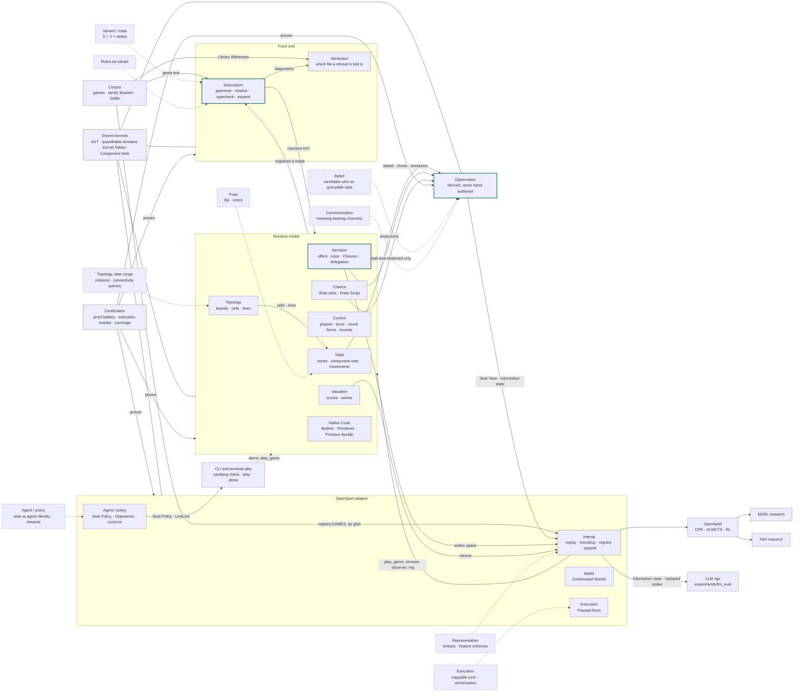

# The engine's domain map

Orientation for the engine's bounded contexts — what exists, how data flows
between them, and where the long-horizon goals (boards, theory-of-mind
research, MARL) dock new domains. This is a map, not spec:
[decisions.md](../decisions.md) wins on any conflict, and the axis arguments
live in [generalization-path.md](generalization-path.md) — this note only
places them. **Maintenance rule:** update this note in the same change that
lands or re-scopes a domain; between such changes it does not churn. A
polished rendering can be regenerated from this note on demand — this file
is the single source of truth.

## The map

Solid arrows are the data flow the code has; dashed arrows dock a future
domain at its anchor. Everything a seat learns flows through Observation —
the derived-information-set moat — and no planned domain changes it, which is
the sign the core abstraction is right.

## Existing domains

| Domain | In plain terms | Registry / anchor |
|---|---|---|
| **Description** (core) | The language: text to checked program, with family libraries and the Stdlib spliced in | grammar productions; AST unions; diagnostics; the totality Owner Guards |
| **Attribution** (supporting) | Which file a refusal is told in, in whose words — the compile-time Failure Channel | `CROSSING_KINDS`; `FIX_TABLE`; the Library Witnesses |
| **Table** | Where physical things are | zone types + `ZONE_PROJECTIONS`; `COMPONENT_SETS` |
| **Topology** (within Table) | Where a board's cells are and how they line up | `BOARD_FAMILIES`; the `cell` position domain and `dir` parameter domain a `board:` clause mints |
| **Decision** (core) | Who may do what, when, from which candidates | move types + guards; declared parameter domains; `DECISION_POINTS`; `ActionSpace` |
| **Observation** (core, the moat) | Who knows what — derived from declared visibility, never authored per game | event vocabulary; per-observer logs; `information_state` |
| **Control** | When things happen; termination | round forms; seating; `ROUND_STATE_FIELDS`; `max_length` |
| **Valuation** | What outcomes are worth | `winner:`; `returns_for` |
| **Chance** | What randomness does | the draw sites; the Shuffle Seed and the Draw Script |
| **Native Code** (supporting) | Python the language calls: Builtins (generic) and Primitives (game-local), reached only through the Primitive Bundle | `CALL_FUNCS`; `PRIMITIVE_IMPLEMENTATIONS`; `WALLED_NAMESPACES`; `PRIMITIVE_READS` |
| **Interop** | Anti-corruption layer to OpenSpiel | `CardlangState`, holding `(seed, script, history)`; encoding; `registry.GAMES` |
| **Agent / policy** | What answers for a seat: a person, an opponent, a trained policy | the Seat Policy; `OPPONENTS` |
| **Belief** (determinization) | Worlds a seat cannot tell from the one being played | the Constructed World; `resample_from_infostate` |
| **Execution** | A line of play held at a decision, so the next pick advances it | the Paused Run seam; `IMPLEMENTATIONS`; `RunPool` |
| **Certification** (supporting) | Evidence about the engine itself | the proof battery; `ZONE_PROBES`; `PAYLOAD_PROBES`; coverage records |
| **Shared kernels** (cross-cutting) | Registries every context imports directly | the AST `Node` union; `DOMAINS`; the Kernel Tables; `COMPONENT_SETS`; the runtime's typed errors |

Description + Decision + Observation are the core domain — derived
information sets are why this engine beats hand-coding games. Native Code,
Attribution and Certification support it, and the shared kernels belong to
no one context: the front end, the runtime and the adapter import them
directly. Each domain's closed registries carry the
[closed-domain completeness](../decisions.md) obligations.

## Where each domain lives in code, and its completeness checks

The code is laid out by pipeline stage (front end → runtime → adapter), not
folder-per-domain — this table is the ownership map. **Placement
convention:** domain logic lives with its consumer when its output IS the
boundary contract — which is why the Observation renderer
(`openspiel/infostate.py`), Valuation's `returns_for`
(`openspiel/replay.py`), Decision's `ActionSpace`
(`openspiel/encoding.py`) and the Seat Policy (`openspiel/seat_policy.py`)
sit in the Interop package: their artifacts (the information state string,
the returns vector, the action ids, an answer in action ids) are the
OpenSpiel contract itself. Do not "fix" their location. The converse holds
too: the text a person reads of a seat's view is an Observation rendering
whose output is not that contract, so it lives in `cardlang/play/`, where the
session that seats a person lives. The one exception to the convention is a
recorded tension (pressure points, "Codecs outside Interop").

| Domain | Code | Completeness checks (the pins) |
|---|---|---|
| Description | `grammar/`, `extract.py`, `parse.py`, `resolve.py`, `typecheck.py`, `types.py`, `expand.py`, `deckcheck.py`, `pipeline.py`, `ir.py`; `libraries.py`, the family-library tier, which is Description's because an import is name resolution (decisions.md "Family libraries"); the Stdlib (`stdlib/rules.cardlang` and its loader `stdlib/rules.py`); the `primitives { }` block is parsed and checked here, against Native Code's registries. Description reads runtime and Kernel Table registries (`runtime/values.py` and `runtime/delegation.py` among them, and `stdlib/`), so its edge with the runtime runs both ways | Surface-totality matrices (movement grid, rejection tests); closed AST unions under `mypy --strict` with `assert_never` dispatches — the checker's `Type` union is the exception, dispatched by isinstance chains, so a missing arm reddens the `Member`-arm classification pin in `tests/test_typecheck_errors.py` instead, which derives its domain from the union (`types.py`); declared-type-name and named-arg rejections |
| Attribution | `diagnostics.py` (span-precise diagnostics: the compile-time Failure Channel), `attribution.py` (which file a refusal standing in family-library text is told in, decided by re-checking the corpus's Library Witnesses) | `CROSSING_KINDS` against `FIX_TABLE` and the walkers, `tests/test_library_attribution.py` |
| Table | `runtime/state.py`, `stdlib/zones.py` (`ZONE_PROJECTIONS`, `PROJECTION_LEVELS`); the Component Sets are a shared kernel | `ZONE_PROBES` against every level `ZONE_PROJECTIONS` declares (tests/test_partition_helpers.py) + probe-time refusal; the card-flavored `DECKS` is derived from `COMPONENT_SETS`, and the deck registries derive from `DECKS` (suits) or are drift-pinned (sizes) |
| Topology | `stdlib/boards.py` (`BOARD_FAMILIES`), `board_domains.py` (the one reader of a game's position domains, for the runtime's candidates and the static action space alike), `rs.board`, the board Builtins (`BOARD_ONLY_CALL_FUNCS`) | Every `BOARD_FAMILIES` row's entry, integrity-pinned (tests/test_boards_registry.py); the `board:` clause (tests/test_board_clause.py) |
| Decision | `runtime/mechanics.py` (the forms' offers), `runtime/execute.py` (offer), `runtime/chooser.py`, `runtime/delegation.py` (`DECISION_POINTS`, Delegated Play), `runtime/rules.py` (the legal-move engine), `runtime/active_rules.py` (the rules a phase and its modes make active), `runtime/subsets.py`, `openspiel/encoding.py` | The quantifiable-domain registry (`domains.py`, a shared kernel) is the one table behind both namespaces — the role nouns and the capitalised move-parameter spellings: resolve's `_ITERATION_ROLES`/`_FIXED_DOMAINS`, typecheck's binder typing, the runtime's `role_members`/`enumerate_domain`, and `execute._for_each`'s actorhood are derived columns, pinned by the domain-by-form matrix (tests/test_domain_registry.py). `for each` and `each … simultaneously` parse any name and guard on those derived role sets at resolve; the `any <noun> where` quantifier spellings are fixed grammar productions, and deriving them from the table is issue #112. Registry-to-dispatcher pins (`CALL_FUNCS`, the round-callback and climb-query name sets); encoder ends in loud errors |
| Observation | `runtime/observe.py` (the event vocabulary, `movement`, `announce`, and `view_of` with its emission-rule raise), `runtime/chooser.py` (where `asked` and `chose` are emitted, inside `decide`), `openspiel/infostate.py`, `play/view.py` and `play/events.py` (the text a person reads); its compile-time Owner Guards sit in resolve, the earliest layer that can decide them — the hidden-read, implicit-pool and delegation guards (`_check_hidden_reads`, `_check_implicit_pools`, `_check_delegation`) among them | `EVENT_PAYLOADS` (each kind and the shape of every field it carries), pinned by an every-game emission sweep; `payload_refusal` refuses an undeclared payload where it is called — `play/events.py`'s event lines and the proof partition — while `render_information_state` and `current_ask` read the log without it, and emission is not fenced against a payload outside the table (issue #638); renderer shape Owner Guards (undeclared value shapes refuse); the partition proof battery, whose per-field payload probes derive from the same table (`PAYLOAD_PROBES` against `PAYLOAD_SHAPES`, tests/test_observation_payloads.py) and certify every rendering of a Seat View — the text's matrix pin runs inside the Chooser over every registered game (tests/test_play_view.py), its event lines exhaustive over the same table |
| Control | `runtime/driver.py` (the phase tree, the decision count), `runtime/execute.py` (the turns loop), `runtime/mechanics.py` (the round forms), `stdlib/round_state.py` (`ROUND_STATE_FIELDS`), `stdlib/hosted_poll.py` | Central decision counting vs `max_length` (one wrapper, every chooser site); the published round state (`tests/test_round_state_registry.py`); the Hosted Poll's body (`tests/test_hosted_poll.py`); round-form surface under Description's totality |
| Valuation | `openspiel/replay.py` (`returns_for`), driver winner handling | Bounded by the `winner:` grammar surface; per-game playout + conservation tests |
| Chance | `runtime/chance.py` (the draw sites, `RefusingRandom`, `ScriptedRandom` and the Draw Script); the generator is chosen by the caller of `play_game` — `openspiel/replay.generator_for` on every adapter route, `cli.py` for the demo playout — and carried as `rs.rng` | The seed/rng non-observability pin; the draw tables reconciled against the grammar (`tests/test_chance_free.py`); replay purity on the adapter path, where the Chooser answers from the recorded history and makes no rng calls. The default `random_chooser` draws from the World's generator, which the CLI shares on purpose, so `generator_for` installs a refusing generator only where no chooser draws |
| Native Code | `builtins/` (the declaration side), `runtime/builtins.py`, `primitives_block.py`, `runtime/primitives.py`, `runtime/reads.py`, `runtime/narrowing.py`, and the game modules `runtime/<game>.py`; the Primitive Bundle (`narrowing.PrimitiveBundle`) is the anti-corruption layer: a Primitive receives frozen values, never `Ctx` or the World | `PRIMITIVE_IMPLEMENTATIONS` equal to `PRIMITIVE_CALL_FUNCS`, asserted at import; `WALLED_NAMESPACES` refuses a walled name in a block; `PRIMITIVE_READS` (tests/test_primitive_reads.py); the values-only interface (tests/test_primitive_narrowing.py) |
| Interop | `cardlang/openspiel/` (`replay.py`, `encoding.py`, `infostate.py`, `registry.py`, `game.py`, `report.py`); `game.py` and `report.py` import pyspiel, and the rest is a pyspiel-free core that terminal play also runs on | Per-game conformance; adapter-agreement proof (doubles as per-game determinism); `registry.GAMES` derived from the corpus directory |
| Agent / policy | `openspiel/seat_policy.py` (`SeatPolicy`, `OPPONENTS`), `openspiel/ranked.py`, `openspiel/replay.py` (`LiveLine`), `play/session.py` (a person at a terminal), `play/opponents.py` (the `--vs` items) | A Seat Policy's signature is its leak-freeness: a Seat View and the legal action ids in, an action id out (tests/test_seat_policy.py); a live line reaches the positions the replay reaches (tests/test_live_line.py) |
| Belief | `openspiel/resample.py`, behind `CardlangState.resample_from_infostate` | A returned world replays to a decision of the same seat with its information state byte-identical (tests/openspiel_ready/test_ismcts.py) |
| Execution | `openspiel/paused.py` (`PausedRun`, `IMPLEMENTATIONS`, `RunPool`) | `replay.run` is the oracle the pool is judged against (tests/test_paused_runs.py) |
| Certification | `tests/openspiel_ready/` (the shared proof harness and one proof module per game), the execution oracles (`tests/fuzz/`, `tests/metamorphic/`, `tests/golden/`, `tests/rejections/`, the native differentials) | Self-pinning: `test_coverage.py` (modules against registry, both directions), probe-table completeness pin (tests/test_partition_helpers.py), coverage records |
| Shared kernels | `ast/nodes.py` (the closed `Node` union), `domains.py` (`DOMAINS`), the Kernel Tables under `stdlib/` (each owned by the domain whose row names it), `runtime/values.py` (`COMPONENT_SETS` the source, `DECKS` derived from it), `runtime/errors.py` (the runtime's typed Failure Channel) | `Node` pinned to the module's dataclasses by derivation (tests/test_node_registry.py); `DOMAINS` by the domain-by-form matrix (tests/test_domain_registry.py) |

When new work touches a domain, its pins are the acceptance floor: extend
the registry and the pins in the same change, per closed-domain
completeness.

## Future domains: anchor and forcing witness

| Domain | Attaches to | What forces it |
|---|---|---|
| Topology, later rungs | Table | The later rungs of [board-topology](board-topology.md), each walled until its witness lands (issue #124), and region/connectivity queries ([generalization-path](generalization-path.md), axis 1); the cyclic rungs wait on issue #953 |
| Pose | Table | Double-sided / orientation-aware pieces: one new verb (`flip`/`orient`) emitting observations like any movement (axis 2) |
| Belief, candidate sets | Observation | Who-knows-what studies: candidate sets as queryable data ([decisions.md](../decisions.md), "Knowledge as candidate sets"), and world enumeration. Determinization is served by the Constructed World, which proposes worlds and accepts those that replay to the seat's information state, rather than enumerating a candidate set |
| Communication | Observation | LLM player seats ([llm-player-seats](llm-player-seats.md)) and convention-bearing bids: meaning in channels, outside the structured partition |
| Representation | Interop | `information_state_tensor` (the roadmap's recorded prize; the adapter registers without it); feature schemas as versioned contracts |
| Execution, branching | Interop | RL-scale throughput: a Paused Run continues along one pick and cannot be copied, so a branch's first query replays its history; a copyable paused game, and vectorized playout, must preserve replay purity |
| Agent / policy, beyond the table | Interop (the replay seam) | Representative playouts; seat vs agent identity; richer reward structure |
| Variant / meta | Description | "X is Y with deltas": MARL curricula and ToM minimal pairs (two games differing in one visibility declaration) from programmatic families |
| Rules as values | Description | Selectable rule sets at runtime (axis 3); effect composition (CCGs) stays the horizon beyond it (axis 4) |

Every future domain arrives under the closed-domain-completeness bar: with
its defining registry, its static pins, and its Owner Guards on day one —
the later topology rungs' relations, pose's verb set, and the tensorizer's
feature schema are all closed domains from birth.

## Pressure points and tripwires

Where corpus growth actually lands, and the signal that says stop and
design rather than accrete:

- **Card games** mostly grow registries inside existing domains (decks,
  Primitives, round axes) — the drilled, pinned path. The first
  genuinely new pressure: observer-dependent phase outcomes (500's open
  misère, Belote's declarations —
  [knowledge-events](../open-questions/knowledge-events.md)).
- **Position explosion** (Table): a game file hand-enumerating cells
  (`square_a1 …`) is the nullary-explosion Owner Guard again — a board's
  position-indexed zones, cells and lines derive from its `board:`
  declaration (`BOARD_FAMILIES`), and every later rung's relation derives
  the same way, never hand-written per game.
- **Connectivity escape hatch** (Description): a game-local Python
  primitive computing over geometry (captures, regions, longest-road) is
  the escape-hatch pattern returning; transitive-closure queries hit three
  instances almost immediately, so they become query surface early.
- **Per-object visibility** (Observation — the one moat-level risk):
  a piece whose position is public but identity is hidden (Stratego-class)
  pushes projections from per-zone to per-object-attribute. Its own
  workstream with the partition proofs as acceptance, not an extension.
  Its combat reveals (public functions of hidden state) are likely the
  compound hidden-function probe that unblocks
  [structural-infoset-proofs](../open-questions/structural-infoset-proofs.md)
  — budget both together.
- **In-play dice** (Chance + Interop): all randomness folds into the root
  (`CardlangState`'s seed and Draw Script); the first roll-the-dice game
  forces explicit mid-game chance nodes — a replay-model change, not a
  registry entry.
- **Unbounded lines become the norm** (Control): chess-like games make
  [unbounded-lines-and-max-length](../open-questions/unbounded-lines-and-max-length.md)
  urgent, and their repetition rules need state *history*, which the
  engine does not track. Settle before the first open-ended board game.
- **Codecs outside Interop** (Interop + Native Code): the action-id codecs
  behind the joint and climb forms are the placement convention's one
  exception. `runtime/primitives.py`'s `joint_codec_function` and
  `climb_codec_function` hand the encoder codecs that live in game modules
  (Tichu's combo codec among them; [kernel-migration.md](../kernel-migration.md),
  "Workstream 3 — Combinations and climbing (Tichu)" records why its ids are
  computed rather than enumerated), so Interop conforms to game Python for
  those games' action ids. A further game that needs a hand-written codec is
  the tripwire: every other block's ids derive from the declared surface.
- **The stillness test:** the observation substrate, information-state
  derivation, certification, and Valuation should not move. A design that
  requires changing how information states derive is a moat-level event —
  stop and sign it off, never fold it into a game PR.
